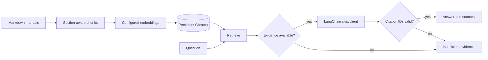

# NimbusDesk Support RAG

Software-support answers grounded in product manuals, with persistent Chroma embeddings, an inspectable LangGraph workflow, and side-by-side model comparisons through LangChain clients.

The scenario is a support engineer investigating a fictional product's installation, authentication, configuration, and operational problems. Ask **"How do I fix AUTH-104?"** to retrieve the authentication manual, receive cited steps, and inspect each workflow stage. An unknown code such as AUTH-999 returns insufficient evidence.

## Features

- Markdown ingestion with section metadata, bounded chunks and stable content IDs.
- Embeddings persisted in `data/chroma/`, alongside source text and citation metadata.
- OpenAI or Ollama embeddings; deterministic lexical hash embeddings for a no-key demo.
- LangGraph retrieval, evidence gating, generation, citation validation, and abstention nodes.
- OpenAI, Azure OpenAI and Ollama chat clients configured through environment variables.
- Up to three model aliases per comparison, all receiving the same retrieved passages.
- Streamlit Ask Support, Compare Models, and Inspect Run views.
- FastAPI endpoints, a CLI, structured run events and optional LangSmith tracing.
- A labeled evaluation dataset and automated integration, failure-handling and UI tests.

## Install

Use Python 3.11 or 3.12 (validation is performed on Python 3.12). Run commands from the repository root.

```bash
git clone https://github.com/Ranausama420/langchain-support-rag.git
cd langchain-support-rag
python -m venv .venv
```

Activate on macOS/Linux:

```bash
source .venv/bin/activate
cp .env.example .env
```

Activate in Windows PowerShell:

```powershell
.\.venv\Scripts\Activate.ps1
Copy-Item .env.example .env
```

Install the tested dependency set and package:

```bash
python -m pip install -r requirements.txt
python -m pip install -e ".[dev]"
support-rag ingest
support-rag ask "How do I fix AUTH-104?"
streamlit run ui.py --server.address 127.0.0.1
```

Open http://localhost:8501. Default configuration requires no API key and makes no model downloads. It uses lexical hash embeddings and extractive answers to demonstrate the workflow; it is not a semantic embedding model or an LLM accuracy benchmark.

## How it works



Ingestion embeds the manual chunks. At query time, the same embedding provider/model embeds the question. Chroma cosine search returns source passages above `MIN_SIMILARITY`. Error-code questions use an exact uppercase-code document filter and bypass the similarity threshold, then verify code boundaries. The language model must return structured claims and supporting source IDs, or abstain.

The similarity gate is a heuristic, not a proof of answerability. Citation validation verifies that referenced IDs belong to the retrieved evidence; it does not prove semantic entailment. Live models can still produce unsupported claims. Tune retrieval and evaluate on your own corpus before operational use.

Re-ingestion upserts current chunks and removes stale chunks. The embedding provider, model and chunk settings determine a collection signature, preventing accidental mixing of embedding spaces. Changes require re-ingestion. Old signature collections remain on disk; this app does not automatically delete them.

## Configure models and embeddings

All settings come from `.env` or environment variables. Environment variables override `.env`. Never commit `.env` or copy keys into source files.

For real OpenAI embeddings and a chat model, edit `.env`:

```dotenv
EMBEDDING_PROVIDER=openai
EMBEDDING_MODEL=text-embedding-3-small
OPENAI_API_KEY=
MODELS_JSON=[{"alias":"primary","provider":"openai","model":"YOUR_CHAT_MODEL"}]
DEFAULT_MODEL=primary
```

Fill the blank key locally and select a chat model available to your account. Then run `support-rag ingest` again. Model and embedding calls may incur provider charges.

For Ollama, start Ollama, download your chosen embedding/chat models using its CLI, then configure:

```dotenv
EMBEDDING_PROVIDER=ollama
EMBEDDING_MODEL=YOUR_EMBEDDING_MODEL
OLLAMA_BASE_URL=http://localhost:11434
MODELS_JSON=[{"alias":"local","provider":"ollama","model":"YOUR_CHAT_MODEL"}]
DEFAULT_MODEL=local
```

For Azure OpenAI chat, use `provider: "azure"` and put your **deployment name** in `model`. Set `AZURE_OPENAI_ENDPOINT`, `AZURE_OPENAI_API_KEY`, and `AZURE_OPENAI_API_VERSION` to the values for your resource. This release uses Azure API-key authentication and does not implement managed identity. Embeddings can independently use OpenAI or Ollama.

### Compare multiple models

```dotenv
MODELS_JSON=[{"alias":"model_a","provider":"openai","model":"YOUR_FIRST_MODEL"},{"alias":"model_b","provider":"azure","model":"YOUR_DEPLOYMENT"},{"alias":"model_c","provider":"ollama","model":"YOUR_LOCAL_MODEL"}]
DEFAULT_MODEL=model_a
```

```bash
support-rag compare "How do I fix AUTH-104?" --models model_a model_b model_c
```

Retrieval happens once. Each model gets the same question, passages, instructions and output schema. Results include source IDs, status, node durations and provider-reported token usage when available. Calls run sequentially; a provider failure does not cancel other answers. Shared retrieval time is separate from each model's time. Provider generation defaults are retained, so these are controlled-input comparisons, not identical-decoding benchmarks. No estimated cost or missing token counts are fabricated.

## Configuration reference

| Variable | Default | Purpose |
|---|---|---|
| EMBEDDING_PROVIDER | demo | demo, openai or ollama |
| EMBEDDING_MODEL | empty | Required for live embeddings |
| CHROMA_PERSIST_DIRECTORY | ./data/chroma | Persistent local vector storage |
| MANUALS_DIRECTORY | ./examples/manuals | Trusted local Markdown corpus; flat directory |
| RUNS_DIRECTORY | ./data/runs | Local JSON run summaries |
| TOP_K | 4 | Maximum retrieved passages, 1-12 |
| MIN_SIMILARITY | 0.15 | Cosine threshold, 0-1; calibrate per embedding model |
| CHUNK_SIZE / CHUNK_OVERLAP | 900 / 120 | Character limits for chunking |
| MODELS_JSON | demo alias | Array of alias/provider/model objects |
| DEFAULT_MODEL | demo | Configured alias used by Ask |
| MODEL_TIMEOUT_SECONDS | 45 | Timeout setting for model clients |
| OPENAI_API_KEY | empty | Required only for OpenAI |
| AZURE_OPENAI_API_KEY | empty | Required for Azure chat |
| AZURE_OPENAI_ENDPOINT | empty | Azure resource endpoint |
| AZURE_OPENAI_API_VERSION | empty | API version supported by your resource |
| OLLAMA_BASE_URL | http://localhost:11434 | Ollama endpoint |
| STORE_TRACE_CONTENT | false | Opt in to storing questions/answers/passages on disk |
| LANGSMITH_TRACING | false | Optional external LangSmith tracing |
| LANGSMITH_API_KEY | empty | Needed for Studio/LangSmith account access |
| LANGSMITH_PROJECT | support-rag | Optional tracing project |

Restart the app after changing configuration. `data/`, reports, `.env` files and logs are ignored by Git. Downloaded comparison JSON includes answer and source content: handle it accordingly.

## API

```bash
uvicorn support_rag.api:app --host 127.0.0.1 --port 8000
```

Interactive API docs: http://127.0.0.1:8000/docs.

| Endpoint | Method | Action |
|---|---|---|
| /health | GET | Process health |
| /models | GET | Configured public model aliases |
| /ingest | POST | Index configured local manuals |
| /ask | POST | Body: `{"question":"How do I fix AUTH-104?","model":"demo"}` |
| /compare | POST | Body: `{"question":"How do I fix AUTH-104?","models":["demo"]}` |
| /runs/{run_id} | GET | Read a saved run summary |

The API and UI are local development tools without authentication or rate limiting. Bind them to localhost. Add appropriate access control before deploying to a shared network. Ingest using one process at a time; local ingestion is not a transactional multi-worker index swap.

## Observe the graph

Every answer returns start/completion/error events with node duration. Inspect Run loads saved JSON summaries. By default, disk records omit the question, answer, claims and source text. Source IDs/names and timings remain. `STORE_TRACE_CONTENT=true` explicitly enables detailed disk records. No hidden chain-of-thought is collected.

For LangSmith Studio (formerly LangGraph Studio):

```bash
python -m pip install -e ".[studio]"
support-rag ingest
langgraph dev
```

The included `langgraph.json` exports the actual graph. Follow the server's Studio URL and submit:

```json
{"question":"How do I fix AUTH-104?","model":"demo"}
```

Studio account/key requirements are documented in the [official Studio guide](https://docs.langchain.com/oss/python/langgraph/studio). Set your LangSmith key locally if required. External tracing is disabled by default; enabling it can transmit prompts, documents and outputs to LangSmith. Studio executes the graph directly; disk run summaries are created by the service/API/UI, not the Studio entry point.

## Test and evaluate

```bash
python -m pytest -q
python -m ruff check .
support-rag evaluate --output reports/evaluation.json
```

The 12-case fixture measures expected-term coverage, citation-ID validity and correct abstention. It is small, synthetic and not a general quality benchmark. The evaluator exits nonzero for failed cases. Replace or extend the dataset for your product and review answer support manually. Test results and live-integration limitations are documented in [validation](docs/validation.md).

## Docker

```bash
docker build -t support-rag .
docker run --rm -p 127.0.0.1:8501:8501 --env-file .env -v support-rag-data:/app/data support-rag
```

Use the sidebar's **Index sample manuals** button before asking questions. The named volume preserves Chroma and run data. A host-local Ollama server needs a container-reachable endpoint configured by the operator.

## Code navigation

See [architecture](docs/architecture.md) for boundaries and tradeoffs, and [code walkthrough](docs/code-walkthrough.md) for module-by-module explanations. The sample manuals are original fictional content. They contain fictional NimbusDesk commands; do not execute them as repository setup commands.

## References

- [LangChain ChatOpenAI](https://docs.langchain.com/oss/python/integrations/chat/openai)
- [LangGraph Studio](https://docs.langchain.com/oss/python/langgraph/studio)
- [Chroma](https://docs.trychroma.com/)
- [OpenAI embeddings API](https://developers.openai.com/api/reference/resources/embeddings/methods/create)

## License

MIT. See [LICENSE](LICENSE).
